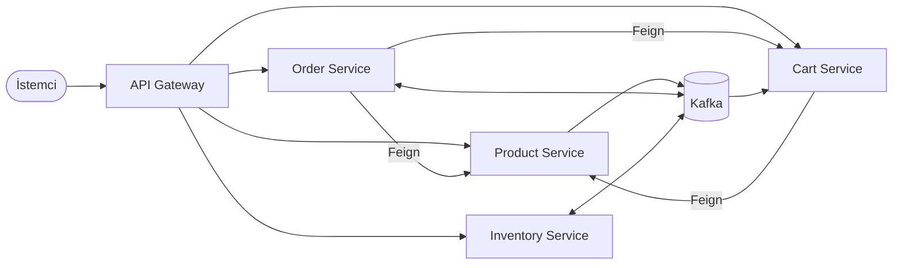

# MarkFlux

Java 21 ve Spring Boot 4 ile yazılmış, mikroservis mimarisinde bir e-ticaret backend projesi.
Ürün, stok, sepet ve sipariş yönetimini ayrı servislerde yapar. Servisler REST (Feign) ve Kafka ile haberleşir.

## Mimari



Her servisin kendi PostgreSQL veritabanı vardır. Bir servis başka bir servisin veritabanına erişmez.

## Servisler

| Servis | Port | Görevi |
|---|---|---|
| api-gateway | 8080 | Tek giriş noktası: yönlendirme, JWT kontrolü, rate limiting, circuit breaker |
| product-service | 8081 | Ürün ve kategori yönetimi, ürün arama, Redis cache |
| inventory-service | 8082 | Stok takibi, sipariş için stok rezervasyonu, stok hareketleri |
| cart-service | 8083 | Kullanıcının sepeti |
| order-service | 8084 | Sipariş oluşturma ve sipariş durumu yönetimi |
| common | - | Servislerin ortak kodu: hata yönetimi, güvenlik yardımcıları, outbox ve inbox |

## Teknolojiler

Java 21, Spring Boot 4.1, Spring Cloud Gateway, OpenFeign, Resilience4j, Kafka, PostgreSQL, Flyway, Redis, Lombok,
Prometheus, Grafana, Loki, Tempo, JUnit, Mockito, Docker Compose.

## Çalıştırma

Sadece Docker gerekir:

```bash
docker compose up -d --build
```

Önceki bir sürümü çalıştırdıysan, eski veritabanını silip temiz başlat:

```bash
docker compose down -v
```

| Adres | Açıklama |
|---|---|
| http://localhost:8080/swagger-ui.html | Tüm servislerin API dokümantasyonu |
| http://localhost:3000 | Grafana (admin / admin) |
| http://localhost:9090 | Prometheus |
| http://localhost:8090 | Kafka UI |

Docker Compose geliştirme ortamı içindir: gateway `dev` profiliyle açılır ve varsayılan `JWT_SECRET` kullanılır.
Gerçek ortamda en az 32 karakterlik yeni bir `JWT_SECRET` verilmelidir.

## Örnek kullanım

Geliştirme ortamında token gateway'den alınır:

```bash
ADMIN=$(curl -s -X POST localhost:8080/auth/token -H 'Content-Type: application/json' -d '{"username":"admin","roles":["ADMIN"]}' | jq -r .accessToken)
```

```bash
TOKEN=$(curl -s -X POST localhost:8080/auth/token -H 'Content-Type: application/json' -d '{"username":"alice"}' | jq -r .accessToken)
```

Ürün oluştur ve stok ekle (stok kaydı ürün oluşturulduktan kısa süre sonra Kafka üzerinden açılır):

```bash
PRODUCT=$(curl -s -X POST localhost:8080/api/products -H "Authorization: Bearer $ADMIN" -H 'Content-Type: application/json' -d '{"sku":"KB-001","name":"Klavye","price":1499.90}' | jq -r .id)
```

```bash
curl -s -X PUT localhost:8080/api/inventory/$PRODUCT -H "Authorization: Bearer $ADMIN" -H 'Content-Type: application/json' -d '{"quantity":10}'
```

Sepete ekle ve sipariş ver:

```bash
curl -s -X POST localhost:8080/api/cart/items -H "Authorization: Bearer $TOKEN" -H 'Content-Type: application/json' -d "{\"productId\":\"$PRODUCT\",\"quantity\":2}"
```

```bash
curl -s -X POST localhost:8080/api/orders -H "Authorization: Bearer $TOKEN" -H "Idempotency-Key: $(uuidgen)"
```

Sipariş önce `PENDING` döner, stok ayrılınca `CONFIRMED` olur:

```bash
curl -s localhost:8080/api/orders -H "Authorization: Bearer $TOKEN"
```

## Derleme ve testler

Java 21 gerekir. Testler birim testleridir, Docker gerekmez:

```bash
./mvnw verify
```

## İzleme

- Metrikler: Prometheus, her servisin `/actuator/prometheus` adresinden toplar.
- Loglar: Servisler JSON log yazar, Alloy bunları Loki'ye gönderir.
- Trace: Her istek Tempo'da izlenebilir. Gateway her cevaba `X-Trace-Id` başlığı ekler.

## Dokümanlar

- [Mimari](docs/architecture.md)
- [Servislerin görevleri](docs/service-responsibilities.md)
- [API](docs/api-documentation.md)
- [Veritabanı](docs/database-design.md)
- [Event akışı](docs/event-flow.md)
- [Hata yönetimi](docs/failure-handling.md)
