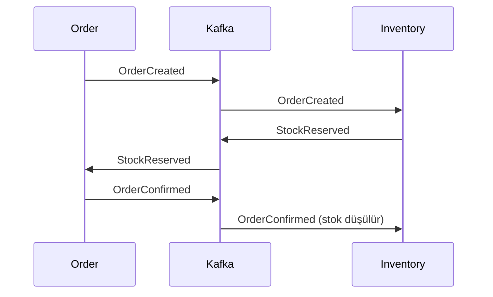

# Event akışı

## Topic'ler

| Topic | Gönderen | Event | Dinleyen |
|---|---|---|---|
| `product.events.v1` | product-service | `ProductCreated` | inventory (stok kaydı açar) |
| | | `ProductUpdated`, `ProductStatusChanged` | cart (sepetteki ürünü günceller) |
| `order.events.v1` | order-service | `OrderCreated` | inventory (stok ayırır) |
| | | `OrderConfirmed` | inventory (stoğu düşer), cart (ürünleri sepetten çıkarır) |
| | | `OrderCancelled`, `OrderFailed` | inventory (stoğu geri verir) |
| | | `OrderShipped`, `OrderDelivered` | şu an dinleyen yok |
| `inventory.events.v1` | inventory-service | `StockReserved`, `StockReservationFailed` | order |

Event'in içeriği JSON'dur. Diğer bilgiler CloudEvents formatında Kafka header'larında taşınır:
`ce_id`, `ce_type`, `ce_source`, `ce_time`, `ce_specversion`.

## Sipariş akışı (saga)

1. Kullanıcı sipariş verir. Order servisi siparişi `PENDING` olarak kaydeder ve `OrderCreated` gönderir.
2. Inventory servisi stoğu ayırır ve `StockReserved` gönderir. Stok yetmezse `StockReservationFailed` gönderir.
3. Order servisi siparişi `CONFIRMED` veya `FAILED` yapar.
4. Sipariş onaylanınca (`OrderConfirmed`) stok kesin olarak düşülür ve ürünler sepetten çıkarılır.
5. Sipariş iptal edilir (`OrderCancelled`) veya başarısız olursa (`OrderFailed`) ayrılan stok geri verilir.
6. 2 dakika içinde cevap gelmezse Order servisi siparişi `FAILED` yapar, 5. adım çalışır.

Bir siparişin tüm event'leri aynı Kafka anahtarını (sipariş id) kullanır, bu yüzden sırası korunur.
Sipariş için açılan rezervasyonların süresi yoktur. Zaman aşımını Order servisi yönetir (2 dk) ve `OrderFailed` ile
stoğu geri aldırır. Rezervasyonda da süre olsaydı, Kafka uzun süre kesildiğinde stok bırakılıp sonra gelen
`OrderConfirmed` stok düşülmeden onaylanmış bir sipariş bırakabilirdi.

`OrderFailed`, `OrderCreated`'dan önce işlenirse Inventory boş bir "bırakıldı" kaydı açar; geç gelen `OrderCreated`
için stok ayırmaz.
